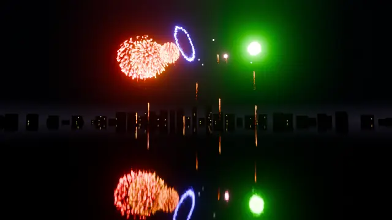
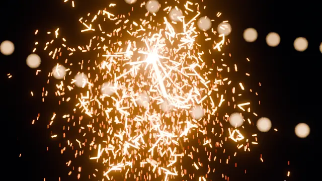
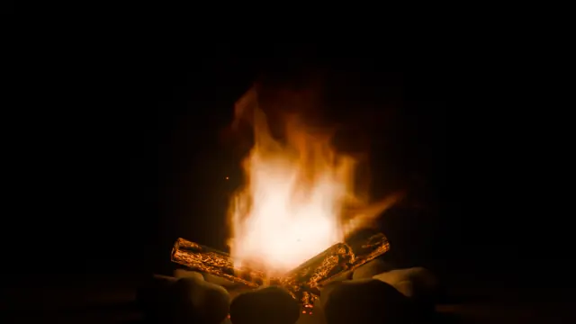
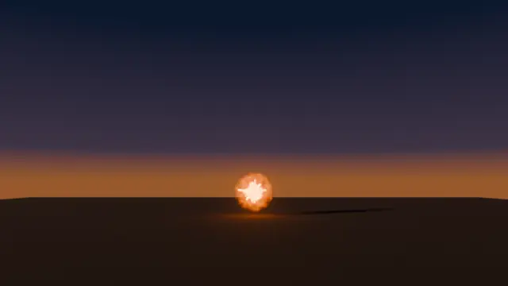
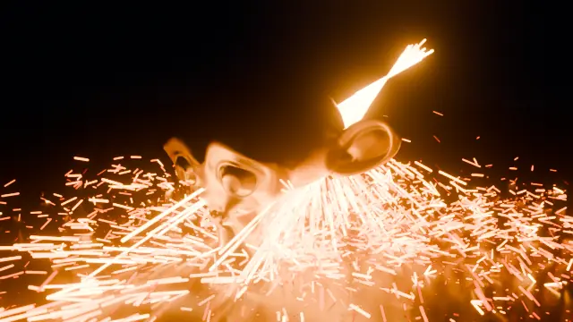
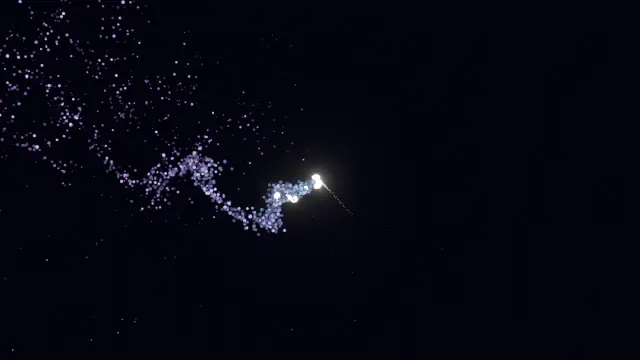
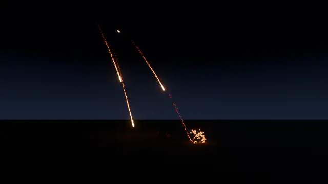
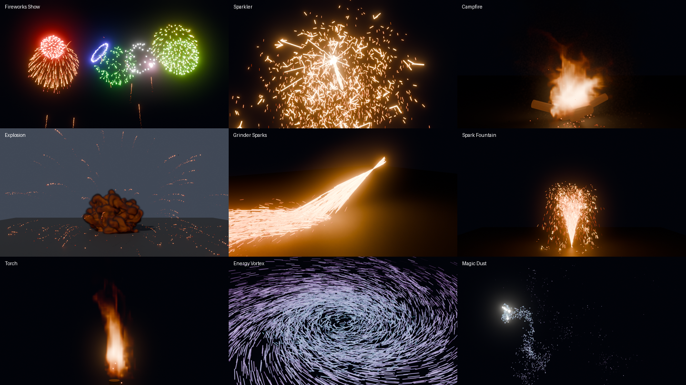

# Nova FX

An optimization-first particle, fire and fireworks engine for Blender 5.2 (works from 4.2).
The simulation runs in a C core with OpenMP. Python only moves data in and out with
zero-copy numpy views, so Blender's UI thread never runs per-particle Python.

## Install

The add-on lives in `addon/nova_fx` and is symlinked as a Blender extension:

```
~/.config/blender/5.2/extensions/user_default/nova_fx -> addon/nova_fx
```

Enable **Nova FX** in Preferences → Add-ons. The core (`lib/libnovacore.so`) is built for this CPU
(`-march=native`). If it's missing, the add-on compiles it on first use (needs gcc or clang). To rebuild by hand:

```
make -C core
```

## Use

- **3D Viewport → Sidebar → Nova FX → Add Effect**, or **Shift+A → Nova FX**.
- Turn on *Camera, World & Glow* in the operator panel for a framed shot, night sky and bloom.
- Press **Play** for a live preview (it simulates as the timeline moves forward; jump to the start to reset).
  Press **Bake** to write every frame to disk (Esc stops). Scrubbing reads the cache.
- To make any object an **Emitter / Collider / Force**, select it and use the buttons in the Nova FX panel.

### Presets

| Preset | What it shows |
|---|---|
| Fireworks Show | 11 shell types: peony, chrysanthemum, willow, palm, ring, crossette, crackle, strobe, heart, multicolour, colour change |
| Sparkler | Iron sparks that fork in flight (split events), incandescent colour |
| Campfire | Combustion fluid, embers riding the flow, popping sparks, logs with glowing cracks |
| Torch | Small licking flame |
| Explosion | Fuel burst with volume expansion, fireball into rolling smoke, debris that trails smoke into the grid |
| Grinder Sparks | Directional spray that bounces and spatters on impact |
| Spark Fountain | Gerb with glitter |
| Magic Dust | Twinkling gradient trail behind an animated wand |
| Drifting Embers | Buoyant embers in wind |
| Energy Vortex | Vortex + attractor forces, streak display |
| Snow | Lit flakes that settle |
| Powder Snow | Fine dry powder drifting and swirling |
| Wet Snow | Big six-armed crystal flakes that tumble down and lie where they land |
| Blizzard | Snow driven sideways by a strong gusting wind |
| Sleet | Icy pellets that fall fast, bounce and chip |
| Snow Globe | A shaken globe: flakes swirl inside the glass and settle |
| Rain | Streaking rain that splashes and rings a wet surface with ripples |
| Cherry Blossoms | Petals drift and flutter on the breeze and gather on the ground |
| Autumn Leaves | Red, orange and yellow leaves tumble down and settle |
| Particle Logo | Dust assembles into a word (any text, logo or mesh) with the Form force, holds, then scatters |
| Splash Tank | FLIP liquid: a column of water falls, wraps around a ball and sloshes in a tank |
| Honey Pour | Thick honey poured onto a plate: the stream buckles and coils as it lands |
| Lava Flow | Lava runs down a slope, glowing where hot, a dark crust where it cools |
| Melting Text | Wax letters soften under a moving heat lamp and slump into a puddle |
| Slime | A blob of slime drops onto steps and oozes down them |
| Blood | A pool of blood wells up and creeps across a tiled floor |
| Portal | A spinning ring flings sparks while ribbons of light swirl inside it |
| Spell Circle | Motes draw a turning spell circle on the ground; lights rise from it |
| Wisps | Will-o'-wisps wander through the dark, drawing trails and shedding motes |
| Arcane Orb | Light orbits a floating orb while arcs of lightning crackle out from it |
| Spirit Smoke | Glowing mist that shines cyan where it is fresh and fades to violet |
| Burn Away | An object disintegrates along a ragged glowing front, shedding embers and ash |
| Lightning | Cloud-to-ground strike grown by the dielectric breakdown model: stepped leader, return strokes, cooling afterglow, impact spatter. With *Camera, World & Glow*, a cloud deck the flash lights from inside |
| Empty System | Starting point |

## Examples

Every example below is a script in [`examples/`](examples) that builds the whole scene from an empty
file, simulates it and renders it. Run one headless with
`blender -b --factory-startup --python examples/<name>.py`. Add `-- --quick` for a fast, low-quality pass.

<table>
<tr>
<td width="50%"><br>
<b>Fireworks over a lake</b>: eleven shell types, colours from real metal-salt emission lines,
reflections in rippled water. <a href="examples/fireworks_lake.py">fireworks_lake.py</a></td>
<td width="50%"><br>
<b>Sparkler close-up</b>: iron sparks that fork in flight (split events), incandescent Planck colour,
85 mm depth of field. <a href="examples/sparkler_bokeh.py">sparkler_bokeh.py</a></td>
</tr>
<tr>
<td><br>
<b>Campfire at night</b>: combustion on the GPU solver, embers riding the flow, a stone ring lit by
the fire. <a href="examples/campfire_night.py">campfire_night.py</a></td>
<td><br>
<b>Explosion</b>: expanding fuel burst into a rolling fireball and smoke cloud; debris trails sparks and
smoke of its own. <a href="examples/explosion_sequence.py">explosion_sequence.py</a></td>
</tr>
<tr>
<td><br>
<b>Sparks on a mesh</b>: an exact mesh collider (distance field) with continuous collision, so sparks
don't pass through the thin ears. <a href="examples/grinder_monkey.py">grinder_monkey.py</a></td>
<td><br>
<b>Magic wand</b>: a twinkling trail that shifts colour, swirled by divergence-free curl noise.
<a href="examples/magic_wand.py">magic_wand.py</a></td>
</tr>
<tr>
<td><br>
<b>Meteor shower</b>: a custom effect written from scratch (below), with no preset involved.
<a href="examples/meteor_shower.py">meteor_shower.py</a></td>
<td><br>
<b>Lightning storm</b>: bolts grown by the dielectric breakdown model. A stepped leader, return strokes
that light the cloud deck from inside, re-strikes down the hot channel, an afterglow that cools to orange,
and one bolt drawn to a lightning rod. <a href="examples/lightning_storm.py">lightning_storm.py</a></td>
</tr>
<tr>
<td colspan="2"><br>
<b>The presets</b> straight out of <i>Add Effect</i>, untouched.</td>
</tr>
</table>

Full-size stills sit next to each loop as `docs/examples/<name>.jpg`.

### Build an effect in Python

Particle types are the building blocks. Each type has a lifetime, motion, a light model, and *events*
that spawn other types: on death, along a trail, on a split, or on impact. This is the whole meteor
shower above:

```python
import bpy, math

bpy.ops.nova.add_preset(preset="EMPTY")      # an empty system + one emitter
sky = bpy.context.object
n = sky.nova
n.kinds.clear()

def kind(**settings):
    k = n.kinds.add()
    for key, value in settings.items():
        setattr(k, key, value)
    return k

# hot rock: Planck colour, leaves a trail, bursts into sparks when it hits something
kind(name="Meteor", color_mode="BLACKBODY", temp0=3200, life_min=3, life_max=4, emit=60, collide="DIE",
     size_start=0.06, size_end=0.04, trail_kind="Trail", trail_rate=180, hit_kind="Spark", hit_count=60, hit_speed=9)
kind(name="Trail", color_mode="BLACKBODY", temp0=2400, cool=1.8, life_min=0.5, life_max=1.2,
     size_start=0.035, size_end=0.0, emit=25, drag_lin=1.5, gravity=0.2, collide="NONE")
kind(name="Spark", color_mode="BLACKBODY", temp0=2600, cool=1.5, life_min=0.6, life_max=1.6,
     size_start=0.02, size_end=0.006, emit=40, drag_quad=0.5, collide="BOUNCE", bounce=0.35,
     split_kind="Spark", split_rate=1.5, split_count=2, split_max_gen=1)
n.display = "STREAKS"

em = bpy.data.objects["Nova Emitter"]                # meteors enter high up, aimed down and across
em.location = (-14, 30, 26)
em.rotation_euler = (math.radians(130), 0, math.radians(35))
e = em.nova_emitter
e.kind, e.shape, e.radius = "Meteor", "SPHERE", 6.0
e.rate, e.random_timing, e.speed, e.spread = 2.2, True, 26, math.radians(6)

bpy.ops.mesh.primitive_plane_add(size=200)          # anything can be a collider
ground = bpy.context.object
ground.nova_collider.enabled = True
```

Press Play to watch it live, or *Bake* to cache it to disk. The same settings appear in the sidebar
(**N → Nova FX**), so you can build effects there and script them later, or the other way round.

## What it does, and how

### Particles (`core/nova_core.c`)
- **Structure-of-arrays storage, fully parallel:** 1M particles × 4 substeps with 2-octave curl noise
  takes ~80 ms/frame on 16 threads; without noise it's ~33 ms.
- **Deterministic:** randomness comes from hashing (particle id, step, salt), and births are placed by
  a parallel prefix sum. Thread count never changes the result (tested).
- **Event graph per particle type** (like X-Particles' Questions/Actions or tyFlow events):
  - on death: burst with a pattern (Fibonacci sphere, random, ring, palm, crossette, heart, cone, hemisphere)
  - trail: continuous children spread along the frame segment
  - split: Poisson-timed branching with a generation limit (sparklers)
  - on impact: spawn children
  - Children can inherit colour; random hue per shell.
- **Forces:**
  - gravity
  - linear drag, plus implicit quadratic drag (unconditionally stable)
  - buoyancy from temperature
  - wind (acts through drag)
  - divergence-free curl noise (Bridson et al. 2007) with analytic gradient noise
  - force objects: attract, vortex, wind, turbulence, drag
- **Colliders:** plane, sphere, box, or the **exact shape of any mesh**. A mesh is baked once to a signed
  distance field (64³ in about a second) and looked up in O(1). Collider velocity, bounce and friction apply.
- **Continuous collision detection:** each particle sphere-traces its step against every collider's distance
  function, so fast sparks can't tunnel through thin geometry. At one substep, 40 m/s particles vs a 2 cm
  slab: 0% pass through (the previous version let 100% through).
- **Incandescence:** colour comes from the Planck spectrum integrated against CIE 1931 colour matching
  functions (Wyman–Sloan–Shirley fit). Brightness ∝ T⁴ (Stefan–Boltzmann). Cooling is Newton plus
  exact radiative T⁴ cooling, so sparks redden and fade like hot metal.
- **Firework colours:** computed from the real emission lines of the metal salts (SrCl red, BaCl green,
  CuCl blue, Na yellow, Ca orange).
- **Sub-frame emission:** births interpolate the emitter's motion and are pre-aged, so fast emitters
  don't leave bands.

### Fluid (smoke & fire)
- Incompressible Navier–Stokes on a staggered MAC grid.
- **Pressure:** conjugate gradient preconditioned by a geometric multigrid V-cycle (MGPCG,
  McAdams et al. 2010). It converges in 4–6 iterations, where plain CG typically needs hundreds.
- **Advection:**
  - MacCormack with min/max clamping (Selle et al. 2008)
  - advection–reflection (Zehnder, Narain, Thomaszewski 2018), which keeps the swirl energy
    semi-Lagrangian steps lose. It reflects only between two fluid cells.
  - Where a trace leaves the grid, the step falls back to semi-Lagrangian, so open walls stay stable
    (a 128³ fire in a narrow domain holds ~3 m/s for 200 frames)
- **Vorticity confinement** plus curl-noise detail. The noise fades out as the local flow approaches
  half its amplitude, so it adds detail without pumping energy in forever.
- **Combustion:**
  - fuel, ignition temperature, Arrhenius-like burn rate
  - heat release and smoke yield
  - volume expansion fed into the pressure solve, so explosions push outward
- **Sparse tiles (8³), sparse all the way down.** Every per-substep pass follows the effect, not the domain:
  - advection, forces, combustion and both solver levels (fine and coarse) visit only active blocks;
  - the active region is found by scanning only last step's tiles plus tiles a source wrote to;
  - the solver hierarchy is re-typed only where tiles changed;
  - colliders are re-voxelized only when they move, and only inside their boxes;
  - VDB export copies only the active box.

  Memory comes from lazily zeroed pages, so untouched space never becomes resident (256³: 2.1 → 0.5 GB).
  The grid is still stored row by row, so each 4 KB page spans many tiles; tile-ordered storage would cut it further.
- **Safety nets:** expansion capped per substep, and face velocity clamped to 2× CFL. Adaptive CFL substeps.
- **Two-way coupling:** particles ride the flow (embers) and feed smoke, heat and fuel back into the grid
  (debris trails, smoky shells).
- **Output:** OpenVDB (`density`, `heat`, `flame`, optional `velocity`) written on a background thread
  and loaded as a Blender Volume sequence with a blackbody fire material.

### Liquids (FLIP)
Set *Fire & Smoke → Mode* to **Liquid**, and mark a particle type **Liquid** (Motion). Those particles are
the water. Every emitter shape works (the new **Volume** shape fills a closed mesh), and so do colliders,
music triggers and events.
- **Solver (`lq_substep` in the core):** FLIP/PIC on the same MAC grid and pressure solver as the gas.
  - Particles are bucketed by cell with a counting sort and splatted to the faces in 27 colour passes, so
    no two threads write the same face, with no atomics.
  - Cells are typed liquid, solid or air. Gravity is added, then the gas solver's MGPCG projects with air
    cells as Dirichlet (pressure 0).
  - The new velocity is extrapolated three faces into the air. Particles take
    `FLIP × (own + grid change) + (1 − FLIP) × grid` and move through the grid at the midpoint.
  - Colliders push them out without bouncing. *Walls* are Open, Tank (floor and sides) or Box.
  - Substeps follow the fastest particle (CFL).
- **Measured:** a 0.5 m water column in a 1.6 m tank settles to 0.165 m deep, where its volume says 0.167.
  All 8,000 particles are kept, and the same run repeats exactly. The 76k-particle Splash Tank takes
  60–130 ms per frame.
- **Threads:** the liquid runs on a thread count sized to its work. On a busy machine, all 16 threads on a
  small liquid stalled at barriers (60 ms frames taking seconds); sized threads stay steady.
- **Surface:** a companion `<system> Surface` object meshes the Liquid points in Geometry Nodes. The chain is
  Points to SDF Grid → SDF Laplacian smoothing → an inward offset that keeps the volume → mesh, with a water
  material. *Surface Radius* and *Smoothing* set the look. Points never reach the render; the surface does.
  Bake skips the surface and it is meshed for display. Blender 5.2 crashes meshing zero points, so the
  tree only meshes when there are some.
- **Example:** [`examples/splash_tank.py`](examples/splash_tank.py).

### Weather: shapes for every particle
- **Shapes display:** every particle type can be drawn as a mesh of its own, instanced on its particles by
  Geometry Nodes on a companion object. Shapes are scaled by the particle radius and carry its colour as the
  instancer attribute `Cd`, so one leaf mesh can be red, orange and yellow. Orientation per type:
  - *Tumble*: random, and turning with the distance travelled, so a leaf that lands stops turning.
  - *Along Motion*: raindrops.
  - *Flat*: ripples.
  - *Upright*.
- **Procedural shapes:** a six-armed dendrite snowflake, a notched cherry petal, a folded leaf, a raindrop
  streak, a ripple ring and an ice pellet.
- **Stick now means stick:** a particle that touches a collider with *Stick* stays where it landed, flagged in a
  spare bit of its generation counter. Before, wind kept sliding settled snow and leaves along the ground.
- **Inside Sphere** collider: keeps particles inside a sphere (a snow globe).
- **Rain chain:** drops die on impact into splashes, which crown up and fall back; splashes that land leave
  ripples that grow and fade, flat on the surface.

### Magic: ribbons, portals, spirits
- **Light ribbons** (Display → *Light Ribbons*): each particle draws a glowing trail through where it was over the
  last *Trail Frames*.
  - The trail comes from the cache: earlier frames are read back and matched by particle id, so a ribbon is
    exactly the path the particle took. There is no extra simulation state.
  - Written to a companion Curves object as Catmull-Rom curves. The width tapers and the glow fades toward the
    tail, drawn with the system's own material.
  - *Show Heads* also draws the particles as points.
- **Around Z** emitter direction: particles leave sideways, around the emitter's Z axis. Spin a ring and sparks
  are flung off it.
- **Spirit** gas look: the fire solver's smoke shines instead of absorbing. It is coloured from *Color* (fresh,
  still hot) to *End Color* as its heat fades.
- **Presets:** Portal (sparks flung off a spinning ring, ribbons swirling inside), Spell Circle (motes form a
  generated sigil of rings, a star polygon and rune marks, which turns slowly), Wisps, Arcane Orb (ribbons
  held in orbit by a spin and a pull balanced for v²/r, plus lightning arcs to points around it), Spirit Smoke.

### Thick liquids: honey, lava, melting
Particle types now have a **viscosity** (Pa·s: water 0.001, blood 0.004, honey 10, chocolate 25), and the
liquid's **Look** sets the surface material: Water, Honey, Blood, Chocolate, Slime, Lava or the particles' own
colours.
- **Viscosity solve:** Batty & Bridson 2008, *Accurate viscous free surfaces for buckling, coiling and rotating
  liquids*. Each substep minimises Σ ρV(u − u*)²/2 + Δt Σ μV|D(u)|², where D is the strain rate. Normal strain
  sits at cell centres and shear on cell edges, as the MAC grid places them.
  - The control-volume weights V are liquid fractions, so the free surface is stress-free by itself; that is
    what lets a falling rope buckle and coil.
  - Solids count as full in the edge weights, which makes walls no-slip.
  - It is solved matrix-free with Jacobi-preconditioned CG, on a box around the liquid and a compact list of
    unknown faces.
  - Air faces next to the liquid are unknowns too, with zero mass. Holding them at extrapolated values grips
    the surface: a spinning 500 Pa·s blob kept 57% of its angular momentum that way. Free, it keeps 88–90%
    against 91–95% inviscid.
- **Coupling:** viscosity and pressure solves alternate (*Coupling*, default 2). That moves toward the coupled
  Stokes solve of Larionov, Batty & Bridson 2017 (*Variational Stokes*), which shows that split solves lose
  coiling. With one pass the honey folded chaotically; with alternating passes it lays down loops.
- **Nozzles:** a liquid emitter can hold its liquid at the emit velocity, like the mouth of a bottle. A viscous
  stream is under tension; a free source gets yanked down by the rope below and the stream comes in segments.
  The mouth emits on a disc, and sub-frame timing spreads each frame's births evenly along the stream.
- **Heat:** *Visc Temp* thins a type as it warms (μ × e^(k (T₀ − T)/1000 K)). *Conduct* spreads heat between
  neighbouring particles, and *Crust* cools the surface only. A new **Heat** force pulls particles toward a
  temperature.
  - Above 10⁴ Pa·s a particle is frozen: solid, it does not move. The solve caps viscosity at 10³ Pa·s, so it
    stays fast.
  - Melting is a cold, frozen block with a heat lamp; lava is a hot, runny type with a crust.
- **Volume kept:** FLIP particles drift apart over time; the honey doubled its volume without a fix. Interior
  cells that are too sparse (or crowded) get a small target convergence (or expansion) in the pressure solve,
  measured against the liquid's own density when it first appeared.
- **Surface:** carries the nearest particle's colour and glow (so lava glows where it is hot), and is clipped
  to the domain: smoothing would otherwise round flat water out through the floor.
- **Measured:** water spreads 1.08 m in 0.5 s, 5 Pa·s 0.75 m, 50 Pa·s 0.39 m. A frozen block stays put;
  heated to 700 K it runs. The Honey Pour runs about 1 s per frame at 2.5 mm cells.

### Upres
*Fire & Smoke → Upres* writes the fire 2–4 times finer than it is simulated. The method is guided detail
advection, a cheaper relative of wavelet turbulence (Kim et al. 2008):
- A fine grid covers the fluid's active box and follows it as it grows or moves. Cells that enter it start
  from the upsampled simulation.
- Density, heat and flame are advected on the fine grid, by the simulated velocity plus divergence-free curl
  noise scaled by the local gas speed (detail where the gas moves, none where it rests). *Detail* sets the
  strength, *Detail Size* the swirl size in simulation cells, *Detail Speed* how fast it changes.
- No pressure solve. After each frame a correction pulls the fine fields back to the simulation at its own
  scale: two smooth (trilinear) passes, then one exact pass per coarse cell. Coarse averages match to 0.5%
  on average. Only clamping negative values at the plume's edge leaves up to ~7% locally.
- The VDB then holds the fine grid (and its velocity, with *Velocity Grid*). Nothing else changes, and the
  simulation itself runs exactly as before.
- Cost: about 60 ms per frame for a million fine cells on 16 cores. A frame whose upres would need more
  than 60% of free memory writes the simulation grid instead and says so in the panel.
- Measured on the campfire at 48³: half-size voxels, the same total smoke (within 1%), 1.3× the total
  variation, and visibly broken-up flame edges and wisps.
- **Example:** [`examples/campfire_upres.py`](examples/campfire_upres.py) is a close-up simulated at 96 and
  written at 288.

### GPU fluid (Vulkan)
- **Setting:** `Fire & Smoke → Device` is GPU by default. It runs the whole fluid substep in Vulkan compute
  (`core/gpu_vk.c`, `core/shaders/*.comp`) with the state resident in VRAM. Without a Vulkan GPU, or when the
  domain doesn't fit in VRAM, the same simulation runs on the CPU and the panel says so.
- **Same solver:** it mirrors the CPU one kernel for kernel, and the tests check that, dense and sparse: identical
  after one frame, and after 8–16 frames no cell off by more than 0.5% of peak. Repeated runs give bit-identical results.
- **Sparse like the CPU:** every kernel runs one workgroup per active 8³ tile (the multigrid levels per active
  block), so the work follows the effect, not the domain. The CPU still does the tile bookkeeping: the GPU
  reports which candidate tiles hold anything (one small readback), and gets back the tile lists and only the
  stencil blocks that changed. Tiles that leave the region are cleared on the GPU, as on the CPU.
- **Pressure solve:** MGPCG with the CG scalars kept on the GPU. The host syncs once per batch of 6 iterations.
  The coarsest multigrid level (≤ 64 cells) is solved in one workgroup in shared memory: 1 dispatch instead of 49.
- **Sources and deposits:** bucketed by tile on the CPU and gathered per cell on the GPU, only in the tiles the
  points reach. No atomics, so results are deterministic.
- **Transfers:** fields come back only for VDB export, and velocity only for particles that ride the flow.
- **Build:** `libvulkan` is loaded at runtime. Shaders are compiled with `glslc` and committed as SPIR-V
  (`core/shaders_spv.h`), so building never needs a shader compiler. Without Vulkan, the add-on falls back to CPU.
- **Limitations:** VRAM is still allocated for the whole domain, and the VDB export and particle coupling download
  whole fields. Small effects bottom out at ~7–9 ms/frame: the pressure solve is ~800 small dispatches per
  substep, so at that size it is bound by dispatch latency, not by cells.

Wall time per frame, small plume in a growing empty domain (`bench/fluid_devices.py`, RTX 3080, 16 threads):

| Cells | Active | CPU sparse | GPU dense | GPU sparse |
|---|---|---|---|---|
| 0.4M | 55% | 25.7 ms | 7.2 ms | 7.5 ms |
| 3.1M | 7% | 26.8 ms | 40.8 ms | 9.2 ms |
| 10.6M | 2% | 34.4 ms | 113.7 ms | 9.2 ms |

A wide fire that fills ~40% of a 6.1M-cell domain: CPU sparse 862 ms, GPU dense 165 ms, GPU sparse 61 ms.

### Lightning
- **Growth (`nv_lightning`):** the dielectric breakdown model (Niemeyer, Pietronero & Wiesmann 1984), the
  Laplacian growth real leaders follow.
  - It is grown with the fast method of Kim, Sewall, Sen & Lin (2007). Every channel point is a charge, so the
    potential at each candidate site is a running sum, updated in O(candidates) per step instead of one Poisson
    solve per step.
  - A candidate joins with probability φ^η. Here φ blends the normalized charge potential (tips reach into high
    potential, which is what makes branches) with the field toward the ground or a strike target.
  - Within striking distance, the gap closes in one straight jump, as when an upward streamer meets the leader.
  - Deterministic per seed. ~850 steps in about 20 ms.
- **Shape:**
  - Side branches with tiny subtrees are pruned.
  - The tree is split into polylines, main channel first.
  - The lattice is broken up with jitter and fractal midpoint kinks.
  - The result is written to a Curves object with per-point attributes: `nova_birth` (when the leader got
    there), `nova_main` and `nova_weight` (the branch's share of the current).
- **Timeline:** keyframed on the material and two flash lights (in the cloud and low on the channel), so it
  renders anywhere without handlers.
  - The stepped leader comes down faint, with bright tips.
  - The return stroke floods the channel and its branches.
  - Re-strikes run down the main channel only, as dart leaders do.
  - The channel cools from plasma temperature to 3000 K, evenly on a reciprocal (mired) scale.
- **Controls:**
  - Shape: seed, branching (η 16 → 8), directness (field weight), step, minimum branch size, fractal detail,
    radius.
  - Timing: strike frame, leader frames, strokes, gap, afterglow.
  - Look: brightness, branch glow, temperature, flash power.
  - Strike target object, and a Nova emitter that bursts at the strike point.
- **Example:** [`examples/lightning_storm.py`](examples/lightning_storm.py) is a storm with three strikes, one
  of them drawn to a lightning rod on a mast.

### Disintegrate
Select any mesh and press **Disintegrate** in the Nova FX panel. A front sweeps through it (or a hole
spreads from inside it), and an Embers & Ash system comes off the front.
- **One number decides everything.** A Geometry Nodes modifier writes `nova_dissolve` on every point: the
  distance in metres past the front (a plane moving along its arrow, or a sphere growing with its
  scale), pushed back and forth by noise that sticks to the object.
  - Below 0 the surface is gone. From 0 to *Edge* it glows (blackbody, hottest at the front). From *Edge* to
    *Edge + Char* it is scorched toward black. Beyond that it is untouched.
- **The material reads the attribute.** Each material is wrapped in a *Nova Dissolve Surface* group, so it
  renders in Cycles and EEVEE with no handlers. The object gets copies of its materials; other objects that
  share them are left alone, and turning Disintegrate off puts the originals back. *Fine Edge* adds
  material-only raggedness below mesh resolution.
- **Particles come off where the surface went.** A *Dissolve Front* emitter reads the same evaluated
  attribute. It emits on triangles that crossed zero during the frame, keeps only the points that crossed,
  and births each one at its sub-frame crossing moment. *Rate* is particles per square metre that
  disappears. Measured: 39,432 born for 10.68 m² gone, against 39,512 expected.
- **Flames:** turn on *Fluid Source* on a Dissolve Front emitter and fuel and heat are fed along the
  glowing band.
- **Example:** [`examples/burn_away.py`](examples/burn_away.py) burns a head from the chin up, with flames on
  the edge.

### Shapes: logos, text and formations
Any object Blender can turn into a mesh can be a shape: meshes, text (and MoBlend MoText), curves and
imported SVG logos. Each object keeps its own sampling settings: *Surface*, *Outline* (the border: best for
flat logos and text), *Edges* or *Vertices*, and a point count. Points are stored in up to 32 slots per
system (`nv_sys_set_shape`) and re-sampled only when the object changes.
- **Form force:** every particle gets its own point of the shape (a hash of its id) and a critically damped
  spring pulls it there: a = ω²(target − x) − 2ζωv.
  - *Pull* (0–1) blends gravity, wind, turbulence and the drags out, so a fully formed shape sits exactly on
    its points. Keyframe it to assemble and release.
  - *Snap* is ω: settled in about 6 / Snap seconds. *Damping* is ζ: 1 arrives without overshoot.
  - The shape follows its object as it moves.
  - Measured: 3000 particles settle on their points within 0.34 mm, with gravity and turbulence on.
- **Shape burst** (death pattern *Shape*): firework stars fly out along the shape's points (turned like the
  object, longest reach = 1). Linear drag stops each star at speed/drag along its direction, so the stars hang
  in the shape. The size comes out ≈ burst speed / linear drag, a percent or two smaller from the stepping;
  the shape itself is exact.
- Forces can now be limited to one **System**. Leave it empty and every system feels the force, as before.
- **Examples:** [`examples/particle_logo.py`](examples/particle_logo.py) (the preset) and
  [`examples/logo_fireworks.py`](examples/logo_fireworks.py) (shells that burst into a word and a star).

### Music sync
Emitters, lightning and any animatable property can follow a song: **Sidebar → Nova FX → Music**.
- **Song:** an audio file (any format Blender plays), a MIDI file of the same song, or both. *Song Starts*
  places it on the timeline, and *Play Along* puts the audio in the sequencer so playback has sound.
- **Audio analysis (`music.py`):** spectral flux per band (log magnitude minus each bin's noise floor,
  positive differences only), with peak picking against a moving average (Böck et al. 2012) and a minimum
  gap. The bands are **Bass** (30–150 Hz: kick, bass), **Mids** (150–2500 Hz: snare body, most
  instruments), **Highs** (5–16 kHz: hats, cymbals) and **Full Mix**. Onsets are compensated for the
  window's latency and land within ~5 ms of the hit, about a tenth of a frame. A 3-minute song analyzes in
  about a second.
- **MIDI:** exact note-ons from a Standard MIDI File (format 0 or 1, every tempo change). Filter by note
  (`36`, `36-38`, `C2`, `F#2-A2`, with C4 = 60), channel and track (number or part of its name).
- **Emitters** (*Music* in the emitter panel):
  - *Burst per Hit*: particles on every hit, scaled by how hard it hits.
  - *Rate by Loudness*: the emission rate follows the band's loudness, or the held MIDI notes.
  - *Every / Offset* let several emitters take turns on one part.
  - **Land on the Hit** emits one lifetime early, with exactly that lifetime, so the death event happens on
    the beat. Firework shells launch early and burst on the kick (`nv_emit_life` in the core).
- **Lightning:** *Strike on the Music* grows one bolt per hit, each with its own seed, impact emitter and
  brightness from the hit. They start up to *Spread* apart. Syncing again replaces them.
- **Drive Properties:** keyframes any numeric property from the song, as *Loudness* or *Pulse per Hit*
  with attack and release: `nova.turb_amp`, `nova.fluid.turb_amp`, `nova_emitter.rate`, `data.energy` …
- *Sync to Music* stores the result in the .blend (hit lists, keyframes, bolts), so simulating and
  rendering never read the song again.
- **Example:** [`examples/fireworks_music.py`](examples/fireworks_music.py) puts seven launchers on the
  kick, snare and hats of a synthesized beat, and writes an mp4 with the sound.

### Blender side
- Native **PointCloud** objects with these attributes: `position`, `radius`, `Cd`, `emit`, `velocity`
  (Cycles motion blur), `age`, `id`, `kind`. Usable in your own shaders and Geometry Nodes.
- **Streak display:** a companion Curves object (`<system> Streaks`) turns each particle into a 2-point curve
  trailing behind its motion. Cycles and EEVEE draw curves natively. At 1M particles, render prep takes
  1.4 s, vs 25 s for the mesh tubes used before. While streaks are on, the point system shows as a
  selectable box.
- **Viewport %** limits how many particles the viewport shows. Renders always use all of them.
- **Cache:** 35 bytes per particle per frame (float16 where precision allows), one `fwrite` per frame.

## Complexity (measured)

N = particles, A = active fluid cells, C = all cells, I ≈ 5 solver iterations at every size.

| Part | Cost per substep |
|---|---|
| Particles | O(N·(1 + forces + colliders)), ~4 ns/particle with no noise, +5 ns per turbulence octave |
| Removing the dead | O(N) only when something died; otherwise children are appended in place |
| Fluid (advect, forces, burn, pressure at every level) | O(A + I·A) |
| Region tracking and solver rebuild | O(changed tiles) + O(C/512) byte scans |
| Collider voxelizing | O(collider box), and only when a collider moves |
| VDB export | O(active box) |

Same plume, empty domain grown from 64³ to 256³ (old → now):
- time: 20 → 113 ms/frame before, now flat at 17–29 ms
- memory: 2.1 GB → 0.5 GB
- VDB export: 800 → 4 ms

4M long-lived particles: 45 → 15 ms per substep.

512³ (134M cells) with a small plume runs at ~32 ms/frame using 2.6 GB. The old dense layout would need ~17 GB.

## Tests

```
python3 tests/test_core.py                                     # core: correctness + speed, ~7 s
blender -b --factory-startup --python tests/blender_presets.py -- --frames 24
blender -b --factory-startup --python tests/blender_lightning.py   # bolt controls, target, timeline
blender -b --factory-startup --python tests/blender_weather.py    # shapes per type, landed leaves still, globe, rain chain
blender -b --factory-startup --python tests/blender_magic.py      # ribbons follow real paths, tangent sparks, spirit look
blender -b --factory-startup --python tests/blender_viscous.py    # nozzle, thin honey stream, looks, melting under a lamp
blender -b --factory-startup --python tests/blender_liquid.py     # FLIP tank: kept, inside, around the ball, meshed
blender -b --factory-startup --python tests/blender_upres.py      # fine VDBs: voxel size, smoke total, detail
blender -b --factory-startup --python tests/blender_dissolve.py    # mask, material, particles and flames agree
blender -b --factory-startup --python tests/blender_formation.py   # sampling, the logo forms, shaped shells
python3 tests/test_music.py                                     # MIDI parsing, onset timing, ~1 s
blender -b --factory-startup --python tests/blender_music.py       # shells burst on the beat, bolts, drives
blender -b --factory-startup --python tests/blender_render.py -- FIREWORKS 260 out.png CYCLES 64
```

## Researched, not built (yet)

Liquids still to come: whitewater (spray, foam, bubbles), surface tension and elasticity (slime is only
viscous), APIC transfers, a multigrid preconditioner for the viscosity solve, and the liquid solver on the GPU.

From the paid tools (X-Particles, tyFlow, EmberGen, Pro Pyro, VFX Pro Simulations):
- APIC liquids (FLIP/PIC is built), granular, cloth
- A particle mesher outside Geometry Nodes (the liquid surface uses Blender's SDF grid nodes)
- ML upres
- A domain that follows the effect around (sparse tiles cover most of that benefit)
- Tile-ordered grid storage (memory proportional to the effect; pages are currently row-shaped)
- SIMD (8-wide) turbulence noise
- GPU particles, and sparse VRAM (tile-ordered storage on the GPU)
